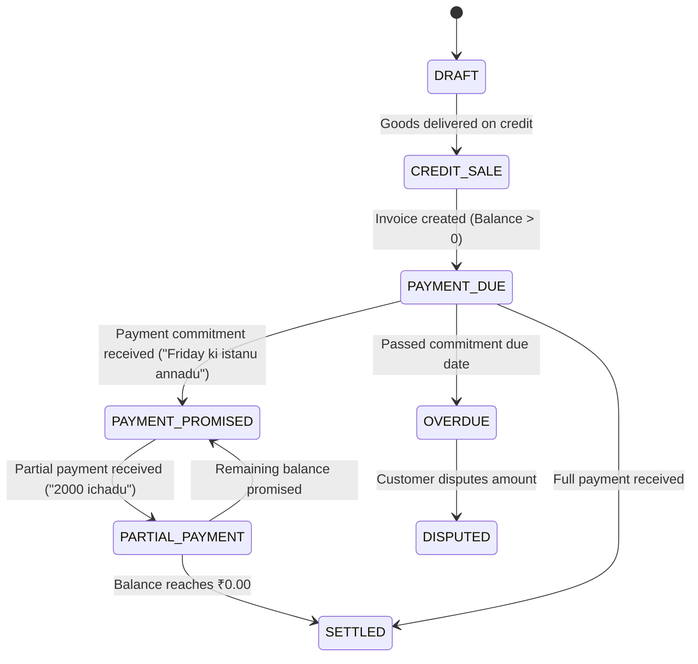

# Architectural Specification: Bilingual Financial Event Intelligence

## 1. Modular NLP Pipeline Specification

| Stage | Module | Key Algorithm / Technique |
| :--- | :--- | :--- |
| **1. Speech Processor** | `speech_processor.py` | Telugu compound spoken numeral parser (*aidhu vandalu* -> 500, *rendu vela 500* -> 2500) + audio waveform visualizer |
| **2. Language ID** | `language_detection.py` | Character n-gram and domain lexicon analyzer (Telugu script, Romanized Telugu, English, Code-Mixed) |
| **3. Code-Switching** | `code_switching.py` | Code-Switching Index (CMI) calculation & Matrix/Embedded token boundary detection |
| **4. Transliteration** | `transliteration.py` | Indic phonetic soundex normalizer (*ivvaali* -> *ivvali*, *icheysa* -> *ichesa*) |
| **5. Entity Extraction** | `entity_extraction.py` | Financial NER for ACTOR, BUSINESS, AMOUNT, CURRENCY, DATE, DUE_DATE, PAYMENT_METHOD, PRODUCT, INVOICE |
| **6. Relation Extraction** | `relation_extraction.py` | Directional role classifier (*ki ivvali* -> Payable vs *nundi ravali* -> Receivable) |
| **7. Temporal Resolver** | `temporal_extraction.py` | Relative date offsets (*ninna* -> -1d, *repu* -> +1d, *vache vaaram* -> +7d, *Friday ki* -> calculated date) |
| **8. Entity Resolution** | `entity_resolution.py` | Alias linking, phonetic Soundex matching, and fuzzy string matching (Ramesh anna/garu -> Canonical Customer ID) |
| **9. Multi-Turn Coreference** | `multi_turn_tracker.py` | Session-level context memory resolving omitted subjects and remaining balances |
| **10. Consistency Engine** | `consistency_engine.py` | Intercepts contradictory settlements, overpayments, duplicates, and impossible dates |
| **11. Ledger Service** | `ledger_service.py` | Double-entry balance calculation, state transitions, and audit trail logging |
| **12. Deterministic Query Engine** | `query_understanding.py` | Semantic intent mapping to SQL AST (zero LLM arithmetic hallucination) |
| **13. Hybrid Document RAG** | `rag/document_service.py` | BM25 + vector search for unstructured store credit policies and invoices |

---

## 2. State Lifecycle Machine

---

## 3. Database Schema Design

- **`customers`**: `id`, `name`, `phone`, `aliases_json`, `outstanding_balance`, `credit_limit`, `credit_score`, `risk_tier`, `last_payment_date`
- **`suppliers`**: `id`, `name`, `phone`, `aliases_json`, `outstanding_balance`, `last_payment_date`
- **`transactions`**: `id`, `event_id`, `counterparty_type`, `counterparty_name`, `transaction_type`, `direction`, `amount`, `balance_after`, `payment_method`, `status`, `date`, `source_text`, `confidence`
- **`financial_event_logs`**: `event_id`, `event_type`, `actor`, `counterparty`, `amount`, `direction`, `payment_method`, `event_date`, `due_date`, `source_text`, `confidence`, `explanation`, `metadata_json`
- **`payment_commitments`**: `id`, `entity_type`, `entity_name`, `amount`, `due_date`, `status`, `source_text`
- **`business_documents`**: `id`, `title`, `doc_type`, `content`, `metadata_json`
- **`audit_logs`**: `id`, `action`, `details`, `actor`, `created_at`
